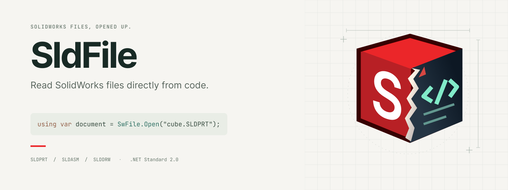
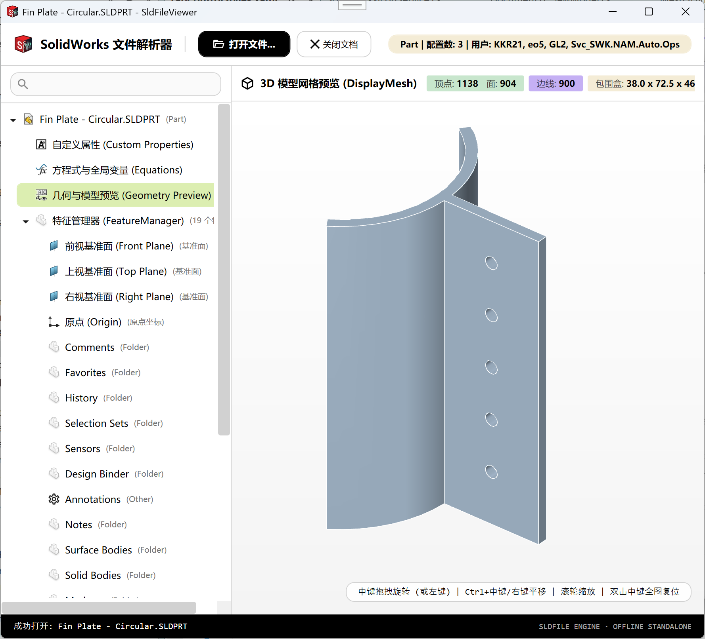

# SldFile

**English** | [简体中文](README.zh-CN.md)

> [!WARNING]
> **Work in Progress**: SldFile is currently under active development. Compatibility testing across different SolidWorks versions and complex documents is still limited. If you encounter unsupported or incompatible files, please feel free to [open an issue](https://github.com/weianweigan/sldfile/issues) (ideally with sample models or diagnostic logs) to help us improve compatibility!

**SldFile** is a pure .NET library designed to inspect, read, and edit SolidWorks files (`.sldprt`, `.sldasm`, `.slddrw`) and sketch templates (`.ske`) offline—completely independent of SolidWorks installations or Windows COM interop.

Targeting **.NET Standard 2.0**, SldFile runs seamlessly across Windows, Linux, and macOS runtimes (.NET Core, .NET 5/6/7/8/9+, and .NET Framework 4.6.1+).



---

## Features

- **No SolidWorks Required**: 100% managed C# implementation. Runs on headless servers, containers (Docker), Linux, macOS, and Windows with zero external CAD dependencies.
- **Full Document Format Support**:
  - Parts (`.sldprt`)
  - Assemblies (`.sldasm`)
  - Drawings (`.slddrw`)
  - Sketch Feature Templates (`.ske`)
  - Supports both legacy OLE Compound File (CFB) and modern section-archive containers.
- **Metadata & Properties Editing**:
  - Read and update standard document metadata: Title, Subject, Author, Keywords, Comments, Company, Manager, Category, Last Saved By.
  - Read and edit document-level custom properties and configuration-specific properties.
  - Strongly-typed values: `string`, `int`, `double`, `bool`, and `DateTime`.
- **Non-Destructive Saving**:
  - Saves only the modified metadata and properties.
  - Preserves untouched streams, geometry, and internal data structures byte-by-byte.
- **Assembly & BOM Extraction**:
  - Inspect full component hierarchy trees with configuration details and transform matrices.
  - Automatically aggregate and compute Bill of Materials (BOM) with quantities and part numbers.
  - Read embedded virtual component documents.
- **3D Geometry & Mesh Export**:
  - Extract and export raw Parasolid binary transmit data (`.x_b`) per configuration.
  - Decode 3D display tessellation meshes (vertices, normals, triangle indices, outlines).
  - Export meshes directly to **Wavefront OBJ** (`.obj`) and binary **STL** (`.stl`).
- **2D Drawing Sheets & Views**:
  - Retrieve drawing sheets, drawing view hierarchies, and referenced model paths/configurations.
  - Extract per-sheet PNG preview images.
- **Sketches & Feature Templates**:
  - Extract sketch entities: points, segments (lines, arcs, circles, splines), relations, and dimensions.
  - Inspect, rename dimension/parameter definitions, and save sketch templates (`.ske`).
- **Visuals & Inspection**:
  - Extract high-resolution PNG and standard BMP preview images.
  - Access external file references, user history, revision logs, and FeatureManager feature lists.

---

## Installation

Install via the .NET CLI:

```bash
dotnet add package SldFile
```

Or via the Package Manager Console:

```powershell
Install-Package SldFile
```

Or add the package reference to your `.csproj`:

```xml
<PackageReference Include="SldFile" Version="1.0.0" />
```

---

## How to Use

### Opening and Saving Documents

Documents are opened in **read-only mode by default** to prevent accidental modifications. Pass `readOnly: false` when you plan to edit and save.

```csharp
using SldFile;

// Read-only mode (default)
using var doc = SwFile.Open("bracket.sldprt");

// Edit mode
using var editableDoc = SwFile.Open("bracket.sldprt", readOnly: false);
// ... make modifications ...
editableDoc.Save(); // Persists changes to disk
```

---

### Detailed Usage Guide

For comprehensive code examples and in-depth usage, please refer to the **[Detailed Usage Guide](USAGE.md)**:

- **[1. Reading and Editing Document Metadata](USAGE.md#1-reading-and-editing-document-metadata)**: Title, Author, Subject, Keywords, Comments, Company, etc.
- **[2. Custom Properties and Configuration Properties](USAGE.md#2-custom-properties-and-configuration-properties)**: Typed property values (`string`, `int`, `double`, `bool`, `DateTime`) across configurations.
- **[3. Extracting Preview Images](USAGE.md#3-extracting-preview-images)**: High-resolution PNG and standard BMP thumbnails.
- **[4. Assembly Hierarchy and Bill of Materials (BOM)](USAGE.md#4-assembly-hierarchy-and-bill-of-materials-bom)**: Component trees, transforms, virtual components, and aggregated BOM lists.
- **[5. 3D Geometry: Parasolid and Mesh Export](USAGE.md#5-3d-geometry-parasolid-and-mesh-export)**: Export Parasolid (`.x_b`) and 3D display meshes to OBJ and STL.
- **[6. 2D Drawing Inspection](USAGE.md#6-2d-drawing-inspection)**: Drawing sheets, views, referenced models, and per-sheet preview PNGs.
- **[7. Inspecting Sketches](USAGE.md#7-inspecting-sketches)**: 3D/2D sketch points, lines, arcs, splines, relations, and dimensions.
- **[8. Working with Sketch Templates (.ske)](USAGE.md#8-working-with-sketch-templates-ske)**: Read and rename dimensions/parameters in feature templates.
- **[9. Document Inspection](USAGE.md#9-document-inspection-references-features-revision-history)**: External references, FeatureManager tree features, users, and revision logs.
